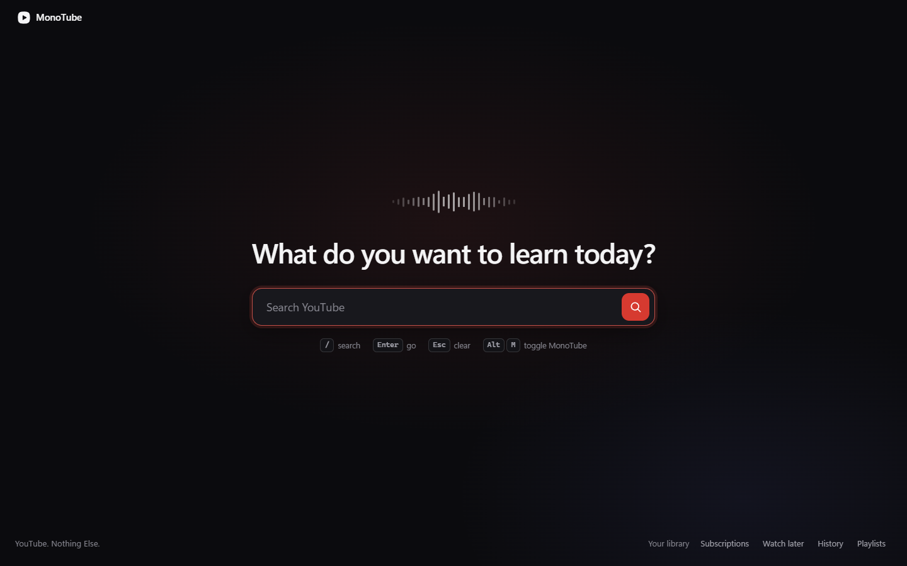
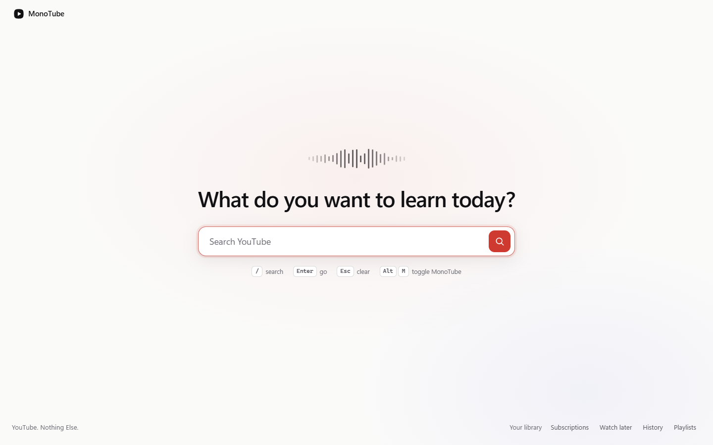
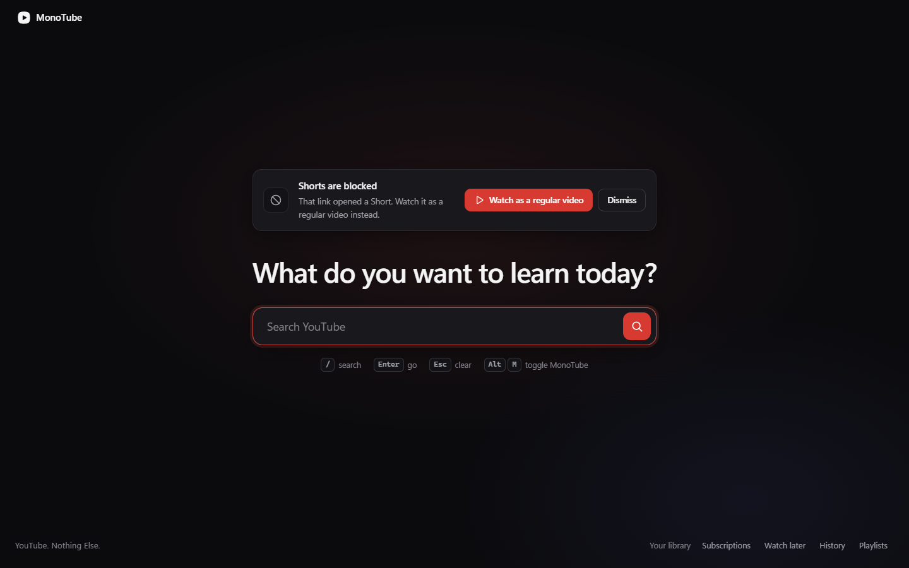
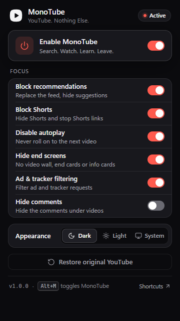
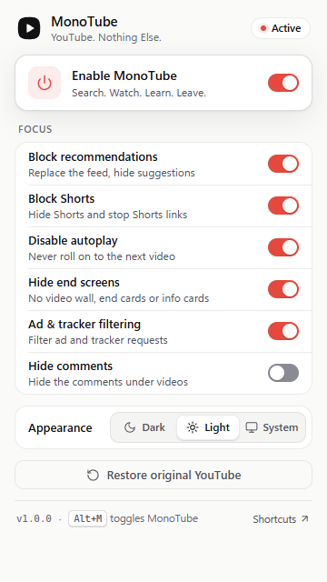

<p align="center">
  
</p>

<h1 align="center">MonoTube</h1>
<p align="center"><strong>YouTube. Nothing Else.</strong><br>Search. Watch. Learn. Leave.</p>

MonoTube is a Chrome / Edge extension (Manifest V3) that turns YouTube into a calm, intent-driven tool.
You open YouTube and get one search box. You search, you get **genuine YouTube results** without the
shelves YouTube mixes in, you watch the video you chose in a clean, centred player, and when it ends nothing
else starts. No home feed, no Shorts, no autoplay, no end-screen video wall, fewer ads and trackers.

> *You decide what to watch. YouTube does not decide what you watch next.*

<p align="center">
  
</p>

---

## Contents

- [Features](#features)
- [Screenshots](#screenshots)
- [Install (Load unpacked)](#install-load-unpacked)
- [Development](#development)
- [How it works](#how-it-works)
- [Project structure](#project-structure)
- [Permissions](#permissions)
- [Privacy](#privacy)
- [Testing](#testing)
- [Known limitations](#known-limitations)
- [Roadmap](#roadmap)
- [License](#license)

---

## Features

| Area | What MonoTube does |
|---|---|
| **Homepage** | `youtube.com` shows the MonoTube homepage instead of the recommendation feed: brand, a large search box, a lightweight animated waveform, *"What do you want to learn today?"*, keyboard hints and quiet links to your own library (Subscriptions, Watch later, History, Playlists). The feed is never rendered, so not even its thumbnails load. Trending/Explore feeds get the same treatment. |
| **Search** | Real YouTube search (no API key, no proxy, no fabricated data). MonoTube drives YouTube's own search box, so results load as a normal in-app (SPA) navigation. Results keep thumbnail, title, channel, duration, views and upload date. Shelves ("People also watched", "For you", "Latest from…"), YouTube Mix tiles and artist-card carousels, search refinement cards, Shorts shelves and Shorts results are removed. Infinite scroll is replaced by an explicit **Show more results** button. |
| **Watch page** | YouTube's own player, untouched: play/pause, volume, speed, quality, captions, theater, fullscreen and keyboard shortcuts all work. The related/up-next sidebar is gone and the player is centred and sized so the title stays visible. The column comes back automatically for things you chose: a playlist, live chat, or an open transcript/chapters panel. Title, channel, description and comments stay (comments can be hidden). A **Back to results** button returns to your search. |
| **Mixes** | YouTube now links most music results into a *Mix*: an endless, auto-generated list of recommendations. With *Block recommendations* on, a Mix opens as the plain video. Real playlists you chose keep their panel, Next button and Shift+N. |
| **Autoplay & end screens** | YouTube's Autoplay toggle is switched off. MonoTube waits for YouTube's *settled* toggle state (YouTube first draws a placeholder), so a setting you already had is never mistaken for MonoTube's change. Autoplay is switched back on when you disable the feature, but only if MonoTube was the one that turned it off. If an up-next countdown still appears, it is cancelled. End-screen video walls, end cards, info cards, the pause-screen suggestions and the fullscreen "more videos" grid are hidden. The player's **Next** button and **Shift+N** are disabled outside playlists. |
| **Shorts** | Shorts shelves, Shorts results, Shorts in the guide and the channel Shorts tab are hidden. Opening a `/shorts/…` link shows a calm notice with **Watch as a regular video** (opens the same video in the normal player) or **Back to search**. Normal short-duration videos are never affected: only the Shorts format is targeted. |
| **Ads & trackers** | A static declarativeNetRequest ruleset blocks third-party ad and analytics domains and YouTube's own ad/telemetry pings (on YouTube pages only). Cosmetic filtering hides promoted results, banner/masthead ads, companion ads, merch/ticket shelves and player overlay ads. In-stream video ads are covered, muted and fast-forwarded at 16×; the main video's mute state and playback speed are restored afterwards. See [limitations](#known-limitations). |
| **Popup** | Enable MonoTube · Block recommendations · Block Shorts · Disable autoplay · Hide end screens · Ad & tracker filtering · Hide comments · Theme (Dark / Light / System) · **Restore original YouTube**. Every control takes effect immediately on open YouTube tabs and persists across restarts (`chrome.storage.local`). |
| **Themes** | Dark (default), Light and System, applied to MonoTube's UI *and* aligned with YouTube's own appearance setting so the whole experience is consistent. |
| **Keyboard** | `/` focus search · `Enter` search · `Esc` clear search / leave a notice · `Alt+M` toggle MonoTube (Chrome command, customisable at `chrome://extensions/shortcuts`). Shortcuts never fire while you type, and the player keeps its own shortcuts. |

### Default settings

| Setting | Default |
|---|---|
| Enable MonoTube | On |
| Block recommendations | On |
| Block Shorts | On |
| Disable autoplay | On |
| Hide end screens | On |
| Ad and tracker filtering | On |
| Hide comments | Off |
| Theme | Dark |

---

## Screenshots

| Homepage (light) | Shorts link opened |
|---|---|
|  |  |

| Popup (dark) | Popup (light) |
|---|---|
|  |  |

---

## Install (Load unpacked)

Requirements: Google Chrome or Microsoft Edge 116+, and Node.js 22.18+ (24 recommended) to build. The build
script imports TypeScript directly, which needs Node's built-in type stripping.

```bash
npm install
```

```bash
npm run build
```

Then:

1. Open `chrome://extensions` (Edge: `edge://extensions`).
2. Enable **Developer mode** (top-right toggle; in Edge, left sidebar).
3. Click **Load unpacked**.
4. Select the **`dist`** folder inside this project.
5. Open <https://www.youtube.com/> (reload any YouTube tab that was already open — extensions are not injected into tabs that were open before installation).
6. You should see the MonoTube homepage. Pin the MonoTube icon to the toolbar to reach the settings popup.

> On the first YouTube page load after installing (or after changing the theme), the page may reload once so
> YouTube can render in the MonoTube theme. See [Themes](#themes-and-youtubes-own-appearance).

---

## Development

| Command | What it does |
|---|---|
| `npm install` | Install dependencies |
| `npm run dev` | Development build of `dist/` in watch mode (unminified, inline source maps). After a rebuild, click ↻ on the extension card in `chrome://extensions` and reload the YouTube tab. |
| `npm run start` | Open a separate Chrome window (own profile in `.dev-profile/`) with `dist/` already loaded — no manual Load unpacked. `npm run start -- --edge` does the same in Microsoft Edge. |
| `npm run build` | Production build into `dist/` (minified) and verification that every file the manifest references exists |
| `npm run typecheck` | TypeScript strict type check |
| `npm test` | Unit tests (Vitest) |
| `npm run test:e2e` | End-to-end tests in real Chrome against live youtube.com (build first) |
| `npm run icons` | Regenerate the PNG/SVG icons from the logo geometry in `src/shared/brand.ts` |

**Why `npm run start` instead of `--load-extension`?** Branded Chrome 137+ ignores the `--load-extension`
switch. The launcher and the E2E fixture use Chrome's supported automation path instead:
`--enable-unsafe-extension-debugging` plus the DevTools Protocol command `Extensions.loadUnpacked`.

### Tech stack

TypeScript (strict) · Vite 8 (three builds: an IIFE content script, an ES-module service worker, the React
popup) · React 19 (popup only) · Chrome Extensions Manifest V3 · `chrome.storage` · `chrome.declarativeNetRequest`
· Vitest + jsdom · Playwright. No runtime dependencies besides React in the popup; no backend; no API keys.

---

## How it works

```
                ┌──────────────── content script (document_start, youtube.com only) ─────────────────┐
 settings ─────►│ index.ts  sets <html data-mt data-mt-recs data-mt-shorts … data-mt-page="watch">     │
 (storage)      │    │                                                                                │
                │    ├─ page.css ── CSS-first hiding, every rule gated on those attributes            │
                │    ├─ router.ts ─ YouTube SPA events (yt-navigate-*), popstate, Navigation API      │
                │    └─ modules (idempotent update(ctx) on init / navigation / settings / OS theme)   │
                │         theme · homepage · nav · search · watch · shorts · ad-filter                │
                └──────────────────────────────────────────────────────────────────────────────────────┘
 service worker: settings ──► enable/disable DNR rulesets "ads" + "shorts", badge, Alt+M, Restore
 popup (React):  reads/writes chrome.storage.local, sends "restore" to the service worker
```

- **CSS first.** Almost all hiding is a stylesheet injected before YouTube renders, gated on `<html>`
  attributes. Toggling a setting flips an attribute: it takes effect instantly, with no DOM scanning, and
  turning MonoTube off removes the attributes so nothing matches any more. Distractions are never painted,
  even for a frame.
- **JavaScript only where CSS can't help:** the homepage overlay (Shadow DOM, isolated styles), the masthead
  navigation pill, the Shorts notice, the "Show more results" pager, the Autoplay toggle, and video-ad handling.
- **YouTube's dynamic DOM.** Selectors are centralised (`src/shared/selectors.ts`) with ordered fallbacks.
  One shared `MutationObserver` (`dom-observer.ts`) is connected only while a task needs it, coalesces bursts
  into one pass per animation frame, ignores nodes MonoTube inserted (no feedback loops) and is disconnected
  when the page no longer needs it. Single elements such as the player are watched with targeted attribute
  observers. Every module cleans up on navigation, and the whole extension tears itself down if its context is
  invalidated (extension updated or removed while a tab is open).
- **SPA navigation.** Search, Home and Back to results use YouTube's own router: MonoTube fills YouTube's
  search box and presses its search button, or clicks YouTube's own links. If YouTube doesn't start a
  navigation, a normal page load is used as a fallback.
- **Trusted Types.** YouTube enforces Trusted Types, so the content script never assigns HTML strings; all UI is
  built with `createElement` helpers.

### Themes and YouTube's own appearance

MonoTube's UI switches theme instantly. YouTube's own pages are aligned through YouTube's **own appearance
preference** (the `PREF` cookie's theme bits). YouTube only renders a theme correctly when its server rendered
the page with it: forcing its `dark` attribute after load produced broken mixed rendering (white text on white
chips). If the MonoTube theme and the page YouTube rendered disagree, the page reloads **once**, *before*
any MonoTube UI is shown, so the reload never interrupts something you started. The reload is guarded per tab
and can't loop. Only the theme bits of the cookie are touched; every other YouTube preference is preserved
(unit-tested). Your original YouTube appearance is saved the first time and restored when you turn MonoTube off
or use **Restore original YouTube**. This is skipped in Incognito, whose cookie jar is discarded anyway.

---

## Project structure

```
monotube/
├── .github/workflows/ci.yml    typecheck, unit tests and build on every push / pull request
├── docs/screenshots/           images used in this README
├── public/icons/               extension icons (generated by scripts/generate-icons.mjs)
├── rules/
│   ├── ad-rules.json           static DNR ruleset "ads": ad & tracker blocking
│   └── shorts-rules.json       static DNR ruleset "shorts": /shorts/<id> page loads → MonoTube notice
├── scripts/
│   ├── build.mjs               production / watch build → dist/
│   ├── launch.mjs              open Chrome/Edge with dist/ loaded (npm run start)
│   └── generate-icons.mjs      render the logo to PNG/SVG
├── src/
│   ├── manifest.ts             source of dist/manifest.json
│   ├── background/service-worker.ts
│   ├── content/
│   │   ├── index.ts            boot + module orchestration
│   │   ├── page.css            CSS-first hiding (gated on <html data-mt-*>)
│   │   ├── router.ts           SPA navigation detection
│   │   ├── dom-observer.ts     shared observer, waitForElement, attribute observers
│   │   ├── youtube.ts          SPA search/navigation helpers
│   │   ├── theme.ts            MonoTube + YouTube theme alignment
│   │   ├── homepage.ts         MonoTube homepage overlay
│   │   ├── nav.ts              masthead pill (MonoTube home, Back to results)
│   │   ├── search.ts           "Show more results", Shorts chip
│   │   ├── watch.ts            Autoplay, Shift+N, Mix → plain video, layout
│   │   ├── watch-autoplay.ts   settled-state detection for YouTube's Autoplay toggle
│   │   ├── watch-player-size.ts re-measures the player when the column width changes
│   │   ├── element-state.ts    remember/restore inline styles MonoTube changes
│   │   ├── shorts.ts           /shorts interception
│   │   ├── ad-filter.ts        in-stream ad muting / fast-forward
│   │   └── ui/                 Shadow DOM root, DOM builders, component CSS
│   ├── popup/                  React popup (App, components, hooks)
│   └── shared/                 settings, storage, selectors, URL helpers, brand tokens, constants
├── tests/
│   ├── unit/                   Vitest
│   └── e2e/                    Playwright against live YouTube
├── CHANGELOG.md
├── LICENSE                     MIT
└── dist/                       build output (not committed) — load this folder in Chrome
```

---

## Permissions

| Permission | Why it is needed |
|---|---|
| `storage` | Save your settings locally (`chrome.storage.local`) so they persist across restarts. |
| `declarativeNetRequest` | Block ad/tracker requests and redirect `/shorts/` page loads with static, declarative rules. Chrome evaluates the rules; MonoTube never sees your network traffic. |
| Host access `https://www.youtube.com/*` | Run the content script on YouTube, allow the Shorts redirect rule, and let **Restore original YouTube** find and reload open YouTube tabs. MonoTube has no access to any other site. |
| `commands` (manifest key, not a permission) | The `Alt+M` shortcut. |

Not requested: `tabs`, `scripting`, `cookies`, `webRequest`, `<all_urls>`, history or any other host.

## Privacy

- No analytics, telemetry or remote servers. MonoTube makes **no network requests of its own**.
- Search queries go only to YouTube, exactly as if you had typed them into YouTube's own search box.
- Settings are stored locally. The last search query is kept in the tab's `sessionStorage` (on youtube.com,
  which already has it in the URL) for **Back to results**, and is gone when the tab closes.
- No browsing history is collected. All code ships in the package; nothing is loaded remotely.

---

## Testing

| Suite | Command | What it covers |
|---|---|---|
| Type check | `npm run typecheck` | TypeScript strict mode across the extension, scripts and tests |
| Unit tests | `npm test` | Settings and the master switch, URL helpers (page types, search paths, Shorts and Mix detection), selector fallbacks, storage, the DNR rulesets, the manifest, page-stylesheet gating, DOM builders, Trusted Types safety, YouTube's `PREF` cookie handling, the Autoplay settle logic and WCAG contrast of every design token |
| End-to-end | `npm run build && npm run test:e2e` | The built extension in real Chrome against live youtube.com: homepage, search, results cleanup, "Show more results", watch page, playback through ads, Autoplay, end screens, the Shorts redirect, SPA navigation, popup switches, themes, settings surviving a browser restart and *Restore original YouTube* |

The ruleset tests include a small matcher for the declarativeNetRequest features MonoTube uses. It asserts that
critical YouTube traffic is never blocked: video streams, the player, search and browse APIs, captions, watch
history, thumbnails, sign-in, BotGuard and the player script. It also asserts that known ad and tracker
endpoints are blocked.

End-to-end notes:

- Branded Chrome 137+ ignores `--load-extension`, so the fixture loads `dist/` through the DevTools Protocol
  (`--enable-unsafe-extension-debugging` + `Extensions.loadUnpacked`).
- `HEADED=1` shows the browser, and `BROWSER=msedge` runs the suite in Microsoft Edge.
- YouTube is live and varies by region and experiment, so tests poll rather than sleep. They skip, rather than
  fail, when YouTube shows a bot check or a consent wall.
- The suite runs locally rather than in CI, because it needs a real browser and network access to YouTube.

Status at 1.0.0 (November 2026, signed out): typecheck clean, 422 unit tests and 22 end-to-end tests passing in
both Chrome 157 and Edge.

---

## Known limitations

- **Ads are reduced, not eliminated.** YouTube serves in-stream ads through the same infrastructure as videos
  (googlevideo.com), so they cannot be blocked at the network level without breaking playback. MonoTube does
  not rewrite YouTube's player responses: that is the approach YouTube actively detects and answers with
  playback errors or "ad blockers are not allowed" prompts. Instead it covers, mutes and fast-forwards ads at
  16× and restores your mute state and playback speed afterwards. Consequences:
  - A long video ad still takes about 1/16 of its length (a 3-minute ad ≈ 11 s).
  - YouTube ignores programmatic clicks on **Skip**, so MonoTube can't skip early. It deliberately never *seeks*
    past an ad: with server-side-inserted ads that would jump inside your actual video.
  - YouTube may change its ad delivery at any time. No ad blocker can promise 100%, and MonoTube doesn't.
- **Network filtering is conservative by design.** It blocks third-party ad and analytics domains and YouTube's
  ad/telemetry pings. It never blocks video streams, the player and search APIs, captions, watch history,
  sign-in or the endpoints YouTube's ad-blocker detection probes. Trackers inside YouTube's own player
  requests are out of reach.
- **YouTube changes its markup often.** Selectors are centralised with fallbacks, and everything degrades
  gracefully: if a selector stops matching, that element simply shows again. Nothing breaks playback. Expect
  occasional selector updates.
- **English-only text matching.** Two small Shorts touches match English UI text: the "Shorts" search filter
  chip and the "Shorts" tab on channel pages. Every other rule uses structure, not text.
- **Theme alignment reloads once.** The first YouTube page load after installing, after changing the MonoTube
  theme, or after turning MonoTube off may reload once so YouTube renders in the matching theme. A live theme
  change switches MonoTube's UI immediately; YouTube's own pages switch on their next load.
- **Uninstalling without turning MonoTube off** leaves YouTube's appearance and Autoplay as MonoTube last set
  them: Chrome gives extensions no chance to clean up on removal. Use **Restore original YouTube** first, or
  change them back in YouTube's own settings.
- **Mixes open as the plain video** (with *Block recommendations* on). That is a full page load, not an SPA
  navigation, so it takes about a second longer than a normal result.
- **Alt+M** is a suggested shortcut. If another extension already uses it, Chrome leaves it unassigned. Set it at
  `chrome://extensions/shortcuts`.
- **Scope:** desktop `www.youtube.com` only. Not `m.youtube.com`, YouTube Music, or embedded players on other
  sites. Tested signed out; signed-in YouTube uses the same page structure but was not tested with a real
  account.
- **Fullscreen** is not covered by the automated tests: Chrome refuses fullscreen requests under automation,
  even on unmodified YouTube. MonoTube does not touch the fullscreen control.

## Roadmap

- Optional MAIN-world player-response filtering behind an explicit "aggressive" toggle, for users who accept
  the detection risk.
- A remotely updatable *selector list* (signed, opt-in) so markup changes can be followed without an extension
  release. MonoTube currently loads no remote code or data at all.
- Per-feature toggles for the subscriptions feed, the channel home tab and comments under specific channels.
- A focus timer / session goal on the homepage ("I'm here to learn X for 30 min").
- Firefox (MV3) build target.
- Localised text matching for the Shorts chip and tab, and a localised UI.

## License

[MIT](LICENSE) — free to use, modify and distribute, with no warranty.
